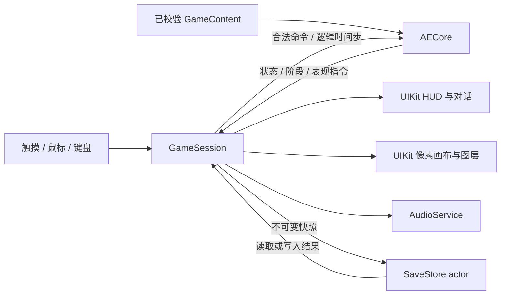

# 远古帝国 II：实现与代码规划

版本：1.3  
日期：2026-10-01  
依据：[REQUIREMENTS.md](REQUIREMENTS.md)  
文档性质：这是 2026-10-01 的实施规划和历史检查点。最新实现、测试数字与未验收边界统一见 [ORIGINAL_ALIGNMENT.md](ORIGINAL_ALIGNMENT.md) 顶部的“2026-10-03 最新基线”。

历史状态：m0 首个可玩纵向切片已实现，并在 iOS Simulator 通过真实输入走到胜利；UIKit 控制器也验证了指挥官阵亡后的失败结果页。正常开局下自然触发失败尚未验收，当时 AI 存在空过回合僵局；完整原版 AI、移动 / 战斗演出、完整内容覆盖以及 iPad 和 iOS on Mac 验收仍未完成。

实现约束：应用与游戏画面全部使用 UIKit，不使用 SwiftUI、`UIHostingController` 或 SpriteKit。像素绘制使用 `UIImageView`、`CALayer` 和 Core Graphics；交互使用 UIKit 手势、控件和 responder 输入。

当时检查点：启动标题、主菜单、m0 剧情、地图、移动与攻击、反击、红军回合、两波增援、胜负判断及自动保存 / 继续已接入纯 UIKit app 与 AECore。iOS 26.5 Simulator UI 测试从标题开始，经真实地图点击走到胜利，并在第一波增援和结尾剧情的自动存档边界终止 / 重启 app 后继续。行动过的单位使用原规则灰图；红军 CPU 会按兵种优先级、HP 和稳定输入顺序调度单位，并对可达格、射程内目标、反击风险和地形防御评分，产生可检查的行动轨迹；当时尚未实现原版完整目标数组、建筑占领 / 修复策略与预约、阻挡者重排、墓碑召唤、招募 / 复活，也未逐项对齐字节码和实测轨迹。移动与战斗结算当时尚无原版演出，开场剧情移动直接落位。

## 1. 推荐方案与首个交付目标

采用 **平台无关的 Swift 规则引擎 + 纯 UIKit 表现层**。菜单、HUD、对话、设置、保存、导航、地图和战斗画面都由 UIKit 实现；像素内容通过 `UIImageView`、`CALayer` 和 Core Graphics 栅格绘制，动画用 `CADisplayLink` / Core Animation 驱动。工程不使用 SwiftUI、`UIHostingController` 或 SpriteKit。创建一个 iOS 应用，同一应用运行于 iPhone、iPad 和支持 iOS on Mac 的 Apple Silicon Mac；不创建独立 macOS 或 Mac Catalyst target。

首个可玩交付不是一张可点击地图，而是：**原算法启动标题 → 主菜单 → 第一关开场 → 教程与回合战斗 → 两批敌人及增援 → 胜利 / 失败 → 保存与恢复**。中途开发产物必须标明哪些只是资源、规则或界面，不称为已经可玩的完整游戏。

技术上先实现可独立验证的规则与流程，再接入画面；启动标题可以在基础设施就绪后优先做，因为它已经有精确原函数指令和参考帧。原版取证与对应功能开发并行推进，不必等所有极端历史问题研究完毕才能写第一关。

### 1.1 规划默认值

以下列出已确认的 UIKit 约束和本方案的推荐默认值；除明确标为用户已确认的项目外，其余用于形成具体任务，不冒充此前用户已经确认的选择。用户之后调整时只修改相关决策和范围。

| 项目 | 本方案默认 | 理由 / 调整位置 |
| --- | --- | --- |
| 界面与绘制框架 | 纯 UIKit | 用户已确认的约束；游戏画面也由 UIKit 图层与像素画布绘制。 |
| 最低系统 | iOS 17，Swift 6 模式 | 满足本方案使用的 Apple API；用户目标设备更老时重新评估，不因本机 SDK 版本抬高最低系统。 |
| 首期平台 | iPhone 完整流程；同一工程纳入 iPad 和 iOS on Mac 基本交互 | 从开始避免触摸专用假设，完整适配在后段验收。 |
| 屏幕 | iPhone 先竖屏；iPad / Mac 视口随可用尺寸布局 | 横屏开放时点以实际布局检查决定。 |
| 启动标题 | 正常冷启动播放展开，可在菜单重播 | 满足用户重点要求；跳过与前情介绍行为在标题阶段核对后确定。后台恢复不重播。 |
| 内容与语言 | 所选 v2.5 内容，保留原英文文本 ID | 中文文本单独准备，现有中文说明不能直接作为完整译文。 |
| 网络 | 离线运行，资源随包提供 | 不接入旧排行榜、网络或账号服务。 |
| 保存 | 一个自动恢复槽 + 三个手动槽 + 独立战役进度 / 设置 | 数量是建议，接口不依赖固定数量；不做云同步和旧 RMS 存档导入。 |
| 自由对战 | 本机真人轮流与 CPU，保留队伍 / 关闭阵营配置 | 全量阶段接入，不作为第一关的前置条件。 |
| 扩展功能 | 地图编辑、导入导出、开发控制台不进入首个可玩交付 | 原格式和资料保留，是否加入完整产品另定。 |
| 音频 | 先评估原 MIDI 在 Apple 音源上的播放 | 评估失败或不可接受时再离线渲染，避免首日确定无法核对的音色。 |

每次实现提交记录对应需求 ID 与原版证据；有意改变原行为的项目登记在未来 `docs/BEHAVIOR_DIFFERENCES.md`。首条差异是重制显示展开动画，而所选 JAR 的 `Disable-Intro:true` 跳过展开。它只改变入口播放策略，不修改战斗或剧情基准。

### 1.2 为什么选择这条路线

| 选择 | 适用性 |
| --- | --- |
| Swift + UIKit / Core Animation / Core Graphics | 输入、生命周期、像素画布和图层动画均由系统框架承载；规则可脱离画面验证；当前资源体量无需游戏引擎。 |
| Unity / Godot | 能完成任务，但会增加引擎、构建与跨语言边界；目前只有 Apple 平台，没有必要先引入。 |
| 把 JAR 放进模拟器 | 可用于原版对照，但不会自然得到现代操作、可靠保存和可维护的规则 / 剧情结构。 |
| Web 重写嵌入 WebView | 可复用浏览器技术，但本项目没有现成网页游戏；增加另一套运行时而没有减少规则还原工作。 |

这里的规则“原生重写”不是重新设计游戏：每个数值、路径、随机调用、状态转换都以现有资源、字节码和实测记录为依据。

## 2. 规划时材料与环境

已存在原资源、解析数据、算法文档、213 个剧情 case、18 个类的参考代码，以及启动标题的原函数隔离执行工具。无需从头反编译或重新生成另一套近似地图。

工程由 XcodeGen 生成，包含 iOS UIKit app、AECore / AEContent 本地 Swift Package、app 单元测试与 UI 自动化 target。规划时环境为 Xcode 26.6（17F113）、Swift 6.3.3、iOS / Simulator SDK 26.5。当时实现只开放 m0；当前已经接通 m0–m7，最新完整验证结果见 [ORIGINAL_ALIGNMENT.md](ORIGINAL_ALIGNMENT.md)。

当前目录尚无 Git 仓库。继续在现有目录实施，不初始化仓库；保留原包、资料和工具。`.noindex/` 用于复用构建缓存和辅助产物，不进入游戏包。

### 2.1 可以直接使用与需要转换的资料

| 材料 | 使用方式 |
| --- | --- |
| `data/units.json`、`terrain.json`、`maps/*.json`、`strings.json` | 由 `tools/export_ios_content.py` 校验并导出到 `AEContent/Resources/GameData`；地图、兵种和地形通过类型化 API 加载。 |
| `data/sprites.json` | 原数据随包保留；图源、变换、锚点和动画序列适配仍待实现。 |
| `campaign-states.json` | 目前存的是 Java 摘录，不是可执行的现代脚本；用于追踪和人工迁移。 |
| 原 PNG / MIDI | 当前从基准 JAR 导出 `res/` 全部 334 项，保留原路径和 SHA-256 清单；运行时按原路径读取。 |
| 启动的 41 个参考帧 | 校验 Swift 波形几何与逻辑像素，不用 GIF 播放替代算法实现。 |
| `AEIIRM_src` / 字节码 | 用于定位调用链和核对歧义；不修改原文件来迎合现代结构。 |

## 3. 工程组织与职责

先用一个 Xcode 工程和一个本地 Swift Package。Package 内只有两个生产 target：`AECore` 与依赖它的 `AEContent`；iOS 表现、应用协调、输入、存储与音频都先在 app target 内按目录组织。单元检查放在 Package tests，UIKit 绘制与保存相关检查放在 app test target，交互检查放在 UI test target。

下面是目标职责结构，按功能增量落地；目前已存在 UIKit app、`AECore`、`AEContent`、标题渲染器、菜单与地图控制器：

```text
AncientEmpiresII.xcodeproj
App/
  Application/          # AppDelegate、SceneDelegate、菜单路由、GameSession、生命周期
  UI/
    Controllers/        # UIKit 页面、容器和导航
    Views/              # HUD、对话、行动按钮和恢复反馈
    Menus/              # 关卡、设置、帮助与保存页面
  Input/                # UIGestureRecognizer、鼠标、UIKeyCommand 输入归一化
  Presentation/
    Canvases/           # UIKit 标题、地图、侧面战斗和过场画布
    Sprites/            # 图源、帧、锚点、变换、调色板
    Timeline/           # 可重建的表现状态、视口和动画游标
  Storage/              # 快照编解码、槽位、原子写入、版本迁移
  Audio/                # MIDI 评估、播放、中断与切换
Packages/AncientEmpiresEngine/
  Package.swift
  Sources/
    AECore/
      Model/            # 地图、单位、阵营、回合、稳定 ID
      Compatibility/    # Java 整数与随机行为
      Rules/            # 移动、战斗、经济、能力、胜败
      Flow/             # 命令、逻辑推进、动作阶段、暂停
      Campaign/         # 8 关初始化、显式状态与条件
      AI/               # 原版排序、目标、评分、招募
      Startup/          # 标题状态、正弦表、逐行几何
      Diagnostics/      # 规则轨迹、随机调用和剧情检查点
    AEContent/
      Loading/          # 类型化解码、校验和版本清单
      Resources/        # 可重复生成的实际游戏内容
  Tests/AECoreTests/
  Tests/AEContentTests/
AppTests/
AppUITests/
tools/                  # 保留现有取证工具，新增内容转换 / 轨迹导出
reference/              # 原版证据，不混入应用源码
docs/                   # 行为差异、需求追踪、平台验收
.noindex/
  DerivedData/
  logs/
  artifacts/
```

`AECore` 可用 Foundation 与 Codable，不依赖 UIKit、图形框架、系统时钟或系统随机数。`AEContent` 负责把校验后的定义与图源清单交给 app；运行时不解析 Java 源码，不启动 Python 工具，不调用网络。

`GameSession` 是应用侧唯一可写会话，初期放在 `@MainActor`；规则本身仍为无平台依赖的值类型。窗口、视图、音频回调和 AI 都不能自行修改单位数组。保存 I/O 在独立串行 actor 中处理不可变快照。先避免后台 AI、多个会话和大规模协议抽象，性能证据需要时再调整。

UIKit 使用代码创建视图与 Auto Layout。`AppDelegate` 只提供应用级 Scene 配置；单窗口 `SceneDelegate` 创建 `UIWindow` 和根容器、持有轻量路由协调器，并在场景失活、进入后台或断开时保存活跃战役。`GameViewController` 组合地图像素画布、UIKit HUD、行动按钮和对话视图；设置、帮助与存档用普通 `UIViewController` 页面。控制器提交命令并根据会话快照更新视图，不在 `viewDidLayoutSubviews`、转场完成或视图出现回调中推进回合。退出游戏页面时明确解除会话订阅与输入响应，视图树按保存的表现游标重建。

每次进程启动均先播放启动页动画，进入主菜单后由用户选择“继续游戏”恢复自动保存的战役或遭遇战；该入口替代已失效的“在线”入口。无自动存档时入口灰显；损坏存档在用户选择继续时提示恢复失败并保留原文件。回到前台仍保留当前页面与对局，Scene 生命周期自动保存机制继续生效。

存档列表仅展示十个手动存档槽，保存和读取均操作所选手动槽；自动存档只由主菜单“继续游戏”恢复。



## 4. 数据模型与确定性边界

### 4.1 主要模型

| 模型 | 必需内容与约束 |
| --- | --- |
| `GameContent` | 内容版本、基准 JAR 哈希、单位 / 地形 / 图块 / 精灵 / 文本 / 地图定义。 |
| `GameState` | 地图变化、单位集合、阵营、轮转、胜败与动态规则状态。 |
| `UnitID` | 持久且不可复用的身份；保留单位插入顺序与主指挥官登记顺序。 |
| `UnitState` | 类型、所属玩家、HP、等级、经验、效果、行动状态、格 / 像素位置、墓碑与复活信息。 |
| `PositionState` | 普通落格、移动起点 / 目的地、剧情离场、墓碑或被删除的区别。 |
| `PlayerState` | 颜色、队伍、真人 / CPU / 关闭、资金、主指挥官和其它登记指挥官。 |
| `TurnState` | 队列、当前玩家与原版 `currentTurn` 计数；队列不是固定按颜色排序。 |
| `FlowState` | 当前动作 / 战斗 / 回合切换 / 召唤等阶段、已结算步骤、剩余等待。 |
| `CampaignRuntime` | 关卡、原状态编号、明确命名的变量、单位引用、动作游标、待消费事件。 |
| `PresentationState` | 视口、位移轨迹、演出游标、必要视觉随机结果；不保存 UIView、CALayer 或闭包。 |
| `SessionSnapshot` | 上述可恢复状态、时钟、随机状态、内容与存档版本、输入锁和快照序号。 |

单位不能建模为“每格唯一的可选单位”。原版查询可区分活单位与墓碑，移动中按目的格查询，剧情允许离场坐标，同格还存在特殊边界。维护有序的单位列表和身份索引，按查询目的显式过滤。字典仅用于查 ID，不靠字典迭代决定 AI / 单位顺序。

地图原始记录与正式战役初始状态分开：先读取 `.aem`，再执行关卡初始化及开场流程。保留原像素偏移和附加字段在证据 / 内容层；不能先删除所有越界单位后再发现开场少了部队。

### 4.2 Java 运算兼容

建立小型 `JavaMath` 适配，只覆盖已实际使用的行为：Int32 运算、向零除法、带符号余数、算术右移、需要的 byte / short 截断，以及明确的溢出。避免把 Swift 默认 Int64 或溢出陷阱当作原 Java 语义。对非负索引、HP 等领域约束另做校验，不能用兼容工具隐藏不合法命令。

随机范围保留原式 `lower + abs(nextInt32()) % (upper−lower)`，不改成 Swift 均匀随机。`Int32.min` 的绝对值边界和水晶零长度攻击区间分别验证；水晶必须走原本的非普通攻击路径。兼容性异常只在明确的决策记录后修复，不在实现中悄悄替换。

### 4.3 随机源必须包含视觉调用顺序

拟实现可序列化的 Java Random 兼容源，先用 Java 已知输入 / 输出序列核对所用算法。原版运行未取得随机种子时，不以“初始场面相同”声称整场随机结果应相同；对照采用记录的原始返回值或明确的固定种子。

**不能初期就把规则和视觉随机源拆开。** 已看到 `MainDisplayable.update` 在建筑烟雾分支调用同一个 `Renderer.rnd.nextInt()`；战斗背景、特效与 AI 招募还有其它消费。若显示刷新次数决定随机调用次数，随后伤害和 AI 会漂移。

处理方式：

1. 按原逻辑更新顺序在确定性流程中分配所有已确认的随机调用。
2. 生成表现指令时把所需随机值固定到演出计划，Renderer 不再随刷新帧重新抽取。
3. 调试记录每次调用的序号、调用点、原始值与消费阶段。
4. 保存随机内部状态与消费序号；这是现代存档增强，原 RMS 未保存随机状态。
5. 与显示层相关的原随机是否暂停、何时消费，也纳入调用链核对；若以后选择独立视觉随机流，必须登记行为差异并重验玩法。

## 5. 命令、动作、时间与更新顺序

### 5.1 命令契约

应用产生语义命令，例如选择单位、请求移动、取消移动、攻击、占领、修复、召唤、招募、待机、结束回合、关闭对话。用户、AI 和剧情共享底层规则能力，但剧情有明确授权的创建 / 离场 / 换阵营动作，不把它假装成普通玩家合法移动。

接受命令时验证：会话仍有效、预期状态序号匹配、当前操作者正确、阶段允许、目标与资源有效。返回接受后的状态和演出计划，或明确的拒绝理由。UI 预览可提前查询范围，但最终必须重新校验；旧异步结果、双击或恢复前的点击不能直接提交到新状态。

普通逻辑事件与一次性副作用分开：

- 可重复从状态重建的画面信息：位置、灰色行动状态、范围、相机。
- 有阶段编号的动作结果：扣血、金币、单位创建 / 删除、任务完成。
- 一次性外部提示：音频切换、震动、提示显示。

事件包含会话 ID、动作 ID、阶段和递增序号，重建 Renderer 不重新应用规则副作用。初期只保存快照与有限轨迹，不采用整场事件日志作为唯一存储的复杂方案。

### 5.2 战斗保留两种原时序

| 模式 | 核心流程 | 保存恢复要求 |
| --- | --- | --- |
| 侧面战斗 | 保存受伤前表现 → 先攻扣血 → 存活且可反击时按受伤后 HP 反击 → 保存演出结果 → 演出 → `finishAttack` 后续处理 | 保存哪些数值已结算、演出结果和游标；恢复不重新抽随机或扣血。 |
| 地图战斗 / 水晶无角色路径 | 先攻 → 原逻辑等待 → 反击 → 再等待 → 后续处理 | 保存当前阶段、剩余等待和已用随机；不能加载时把后段全部补算。 |
| 城镇伪目标 | 按原资格走城镇变废墟流程 | 不引入建筑 HP、普通反击或可存档的真实“伪单位”。 |

“规则独立于表现”不表示整次攻击必须一次性把所有副作用结算完。`FlowState` 是规则定义的阶段流程，表现只读取它。动画完成不能靠一个不可恢复的 `SKAction` 回调直接修改 HP 或推进剧情。

### 5.3 移动与取消

范围和路线先在规则层计算，保留预算严格比较、友敌阻挡、平手方向顺序。动作保存起点、目标、原路径和当前逻辑像素位置；移动中占用查询按原目的格语义处理。常规移动后还能选择后续行动，投石车例外；结束行动、移动完成和取消恢复是不同转换。

剧情直线路径遵守先横后纵，不使用普通地形寻路；允许地图外出生和离场。目标被占时的剧情空位策略按原函数核对，不用通用“最近空格”替代。取消权限按原版实际输入阶段核对，不能任意提供现代无限撤销。

### 5.4 时间与暂停

使用显式的 `ClockDomain`：启动、世界 / 剧情、战斗、对话 / 菜单。一个活动显示层决定当前哪些流程接受逻辑更新，重现原 `currentDisplayable.update()` 的归属。UIKit 布局、视图刷新和控制器转场不推进游戏。

首版兼容调度采用原目标 66 ms 的逻辑步，而内部原计数按每步 +50 维护，脚本等待用步数。UIKit 可在 60 / 120 Hz 刷新；规则、随机和原精灵状态只随逻辑步变化，刷新回调不直接决定规则结果。

推荐最初每次渲染回调至多推进一个到期的逻辑步；处理慢了就延后，不批量补算。这样接近原版“一次更新后绘制，慢设备不补帧”的方式。高频回调会带来一个显示帧以内的时间量化，目标调度精度、长帧及背景恢复要实测；这是规划方案，不能直接宣称已经与录屏墙钟一致。优化前先保存实际逻辑步与显示帧时间轨迹。

进入后台立即冻结当前会话时钟和命令入口，获取一致快照；返回时重设下次步起点，不累计离开时长，不跑补回合。对话是否冻结镜头 / 单位，以及镜头未到目标是否仍扣脚本等待，按原调用路径分别确认。

已确认的世界更新骨架是：`delayCounter += 50` → `updateScript()` → 教程处理 → 仍由游戏画面持有更新权时继续世界逻辑，单位更新位于后段。结束行动事件不能被简单改为本次命令提交后立即执行全部剧情；取证任务要固定完整顺序，特别是脚本末尾清除一次性事件的时点。

## 6. 内容转换与像素表现

### 6.1 构建期内容流程

保留现有 `catalog_game_reference.py` 的研究产物，另加 `tools/export_ios_content.py` 负责游戏消费格式。二者用途分开，避免给浏览器内嵌 data URL 的大 JSON 直接成为 app 数据。

导出契约包括：内容 schema 版本、基准 JAR / 各资源哈希、稳定 ID、地图维度和朝向、单位定义、精灵图源 / 序列 / 变换、文本及原始来源。将实际使用资源按原目录结构拷贝到拟建 `AEContent/Resources`，避免 `blue/king_00` 与 `red/king_00` 在扁平资源目录相互覆盖。

先离线生成并保存，Xcode 只打包已导出内容；不在每次构建中下载工具或重复做全量反编译。每次源内容变化运行导出与校验，再审查差异。首次内容包含全部静态定义和 20 张地图，首期运行模式仅开放已实现部分。

校验图块 / 单位 / 文本 / 帧引用和唯一 ID，保留离场坐标，报告 `buildings.sprite` 历史缺图并按实际使用路径处理。运行时发现缺关键资源时给出可定位错误，不制作替代图掩盖导出问题。

### 6.2 UIKit 像素画布

- 地图画布以左上角为原点，图块按 24×24 逻辑像素定位；点击坐标通过画布实际显示区域和缩放比例逆变换回地图格。
- 大地图浏览由 UIKit 视图容器管理平移 / 缩放，HUD 使用设备点坐标，规则不读取设备分辨率。
- 直接读取 PNG，使用 `CALayer` 最近邻过滤和明确锚点；不先依赖自动图集旋转、裁切或纹理压缩。
- 灰图按原调色板平均规则派生，保留指定浅色，不能简单降低图层透明度或加系统灰度滤镜。
- 精灵帧序列由逻辑 tick 和可保存的演出游标驱动；Core Animation 只呈现预先确定的状态，不能决定逻辑完成时间。
- 调试叠加层显示图格、身份、动作阶段、剧情状态和相机位置，发行版关闭。

### 6.3 原算法标题

在 `AECore/Startup` 保存原正弦表、进度和逐行几何；app `TitleRasterizer` 按原 PNG 生成逻辑 RGBA 帧，缓存 p=0…40 对应纹理，随后按原状态处理背景和扫光。首期选 CPU 逐行栅格，因为图像只有 240×85，便于取整和像素比较；无需先引入 Metal shader。

固定的逻辑画布先采用 240×320，居中显示，外围留黑边或布局背景；不把算法直接在屏幕物理行上运行。未来其它逻辑宽度使用已核对的原定点缩放规则，不能先用 GPU 双线性放大后再裁切。

验证分为：正弦 360 项、41 个进度的裁切 / 位移、PNG 透明区、背景 alpha / 层叠、扫光循环、逻辑间隔、进入菜单输入，以及具体系统字体。原函数指令已有 369 组 / 31,980 行零差异作为参考，但 iOS 栅格与录屏像素仍需实测。

正常冷启动播放展开是产品设置，原包 `Disable-Intro` 留在基准记录里。第一次原型不连同未验证的前情、字体和圆形菜单声称“整个启动 100%”。菜单重播入口便于后续核对，不必重新结束正在进行的对局。

### 6.4 菜单与交互

启动封面、圆形菜单、正文、设置、保存页面和战场全部由 UIKit 表现；战场以 UIKit 行动按钮表达可执行行动。若圆形菜单做主要入口，保留原半径增长、角度收敛、选中与中断语义，并提供可访问的文字入口。像素场景由 UIKit 图层和 Core Graphics 画布绘制。

手势从开始到结束保持一个用途：点击、拖动或缩放，拖动不产生落格命令。Mac 通过 responder 处理方向、确认、取消和必要快捷键；同一命令验证消除触摸与键盘规则差异。启动按键在路由切换时消费一次，不能直接选中菜单项。

交互默认采用点选单位 → 点选合法目标 → 明确行动按钮的流程；Return / Space 确认，Escape 取消，方向键移动格光标。第一关先交付固定地图缩放与拖动；全量阶段提供两个经像素对齐核对的离散缩放档，触摸双指和 Mac 按钮均可切换，不先做任意连续缩放。剧情接管镜头期间冻结手动平移，完成后恢复；缩放不改变规则坐标。这些是现代输入建议，具体触控区域和缩放倍率在 T22 / T80 用实际设备确定。

## 7. 八关剧情的迁移方式

### 7.1 先显式状态，暂不做通用脚本语言

第一阶段为每关建立明确的 Swift 状态流程，保留原 `scriptState` 数字作证据映射。共用有限的条件和动作类型，例如区域与行动状态检查、计数、显示对话、镜头目标、等待、创建 / 删除 / 移动、改阵营和任务结果。

不直接把 Java `code` 字符串当 JSON 脚本运行，不先建设可执行任意表达式的通用 DSL，也不把所有 213 个 case 压缩成只含“坐标和文本”的数据。第一关验证后，真正重复的动作再提取为声明式定义；特殊控制流仍可保留显式函数。

| 部分 | 迁移要求 |
| --- | --- |
| 初始化 | `.aem` 加载之后的金币、解锁、指挥官、创建与入场单独保存。 |
| 全局检查 | 水晶保护、最终关死亡标志等在原顺序执行，不遗漏 switch 外逻辑。 |
| 条件 | 同时携带前置状态、对象身份、阵营、行动结束、回合计数、坐标和计数表达式。 |
| 动作 | 每个动作有编号，执行游标和等待状态可保存；创建 / 删除 / 换阵营只应用一次。 |
| 镜头 | 原函数隐式状态推进改成明确转换，保留完成条件，不产生二次 ++。 |
| 一次性事件 | 结束行动 / 占领等事件按原消费与清除时点保存，重载不漏也不重发。 |
| 对话 | 原 text ID、portrait ID、退出方式及恢复更新权；不按阵营重新分配头像。 |
| 完成 | 区分普通 `completeMission` 和 m7 重建结尾演出的特殊流程。 |

`CampaignRuntime` 使用按关卡区分的 Codable 数据，语义变量名旁记录原字段名与来源；不要用没有约束的大型 `[String:Any]` 承载全部剧情临时变量。

### 7.2 状态动作与异步表现

一个状态可包含多个动作，保存 `actionIndex`、已应用序号、当前等待与效果 ID。规则修改先形成完整的新快照，再发出表现指令；对话、移动和镜头等待以可恢复的模型条件推进，不直接在 UI 闭包中 `scriptState += 1`。

恢复时，已应用的刷兵或删除不能再次运行，未完成的镜头 / 位移从保存进度继续；关闭已显示对话仍只推进一次。目标单位已经由合法剧情删除时要有明确语义，不把失效引用当“随便找同类型单位”。

### 7.3 对应表、触发图和每关检查点

新增人工审查的 `reference/reconstruction/data/campaign-triggers.json` 与状态对应表，字段含来源、证据等级、前置状态、触发 / 出生 / 终点 / 镜头类别。地图浏览页显示这些标记，用它核对编写中的剧情。

对应表不是运行正确性的证明：每关保留状态轨迹，检查同一区域在其它状态不触发、经过不等于结束行动、错误阵营不触发，以及暂停 / 读档后的结果。m0 的两批敌人、m4 的四轮伏击和替代完成、m6 的保护阶段与目标切换、m7 的天怒与结尾优先建立检查点。

## 8. AI 实现与无画面验证

AI 与规则同在 `AECore`，采用原单位排序、目标数组、反向预算、评分和招募顺序，最终输出与玩家相同的合法命令。剧情与 Saeth 特殊行为走专用决策，不伪装为普通评分结果。

扫描顺序显式保留 x 外层 / y 内层、目标列表顺序、同分严格 `>` 和稳定排序。记录每次候选的分数构成、选中目标、支援预约和招募随机值；调试比较可以说明为什么走向某格，而不是只看最后截图。

先同步执行一个有限的决策阶段，用户输入在 CPU 回合锁定。一个逻辑步不递归执行整场战争。检测重复状态或长期无进展时输出诊断并暂停到可恢复状态；阈值是异常保护，不作为正常策略，不能直接跳过原本应执行的单位来掩盖错误。

没有画面的测试驱动推进 Engine、等待和明确的对话确认，生成回合与状态轨迹。只给渲染端假节点还不够：验证必须包含规则状态、随机消费和剧情等待。尚未取得原 AI 对照时标为源码依据，不能以“AI 能打完”代替忠实性验证。

## 9. 保存、后台恢复与失败语义

### 9.1 快照内容

`SessionSnapshot` 包含：schema 与内容版本、基准行为配置、地图与单位、玩家 / 轮转、主指挥官引用、游戏 / 剧情阶段、动作游标、已用随机值和随机源状态、逻辑时钟、演出计划、相机 / 对话、待消费一次性事件、快照序号。

保存新格式，不复刻 RMS 的有符号单位数量 byte、经验 short 截断或没有 RNG 的限制；这是明确的现代数据保存差异。旧 `.aem` 是地图内容，不能把它当实时对局存档。不给存档写入图像缓存、UIKit 对象、计时器或闭包。

### 9.2 保存时点与一致性

每个有规则副作用的阶段完成后，GameSession 维护最新一致快照；自动保存可合并短时间请求，不每个渲染帧写盘。进入后台时在同一隔离上下文冻结会话、拍快照并请求写入；后台执行时间有限，不能依赖这一次写入才有有效进度。

序列号确保晚到的旧写入请求不能覆盖新存档，切换会话后旧异步读写不能作用到新会话。写盘使用临时同目录文件与原子替换，保留上次可读快照 / 备份，成功后才更新槽位元信息。读档先验证版本、校验信息、引用、内容版本与阶段一致性，再替换当前会话。

| 失败 / 中断 | 行为 |
| --- | --- |
| 写入失败 | 保留上次有效存档，显示可重试反馈，当前对局不被删除。 |
| 坏档 | 尝试可读备份；无法恢复时明确说明并允许返回菜单，不自动覆盖。 |
| 内容版本不同 | 有迁移才执行；无迁移时保留文件并报告不兼容，不静默重置。 |
| AI / 战斗 / 剧情中途离开 | 按已保存阶段恢复，不重掷已结算随机、不补算后台时间。 |
| 演出场景重建 | 从模型恢复已有结果与游标，不能再创建军队、扣血或发钱。 |
| 音频中断 | 游戏与音频暂停状态分别管理，恢复音频不推进回合或剧情。 |

只保留一个活跃对局；首期不开放两个窗口编辑同一存档。iOS on Mac 关闭窗口 / 退出也采用已有检查点，不能假定始终会收到充分保存时间。

## 10. 音频方案与评估步骤

先用 `AVAudioEngine + AVAudioUnitSampler + AVAudioSequencer` 做 9 个 MIDI 的验证样例，评估 Apple 平台音源、program change、完整曲目与循环行为。具体 instrument bank 的可用性和随包音源方案必须实测确认，不能因为 API 名称存在就宣布音色已还原。

维持原一个当前播放曲目的切换语义，按剧情 / 战场 / 战斗 / 胜败事件发出明确播放和停止命令；loopCount 0 的无限循环与单次播放分开。切换音频不能触发新的随机抽样或改变剧情等待。

若原 MIDI 实时播放不稳定或音源不合适，再用固定版本音源离线生成音频，并保存源 MIDI、音源版本、采样率、渲染参数和循环核对结果。不要直接按解析时长裁掉尾响或认为文件首尾无缝。设置与 AVAudioSession 的静音 / 混音 / 中断策略在实际样例后定稿。

原代码的 9…14 动作声访问可能在所选包越界后被吞掉，目前无对应声音文件；不为这些调用新增未确认音效。第一关可以先通过静音的规则验收，但不能因此把音频需求标完成。

## 11. 分阶段实施任务与完成门槛

任务按依赖顺序推进；每阶段有可审查交付与验证，不先铺开所有页面。时间估算待第一关规则与剧情迁移实际完成一段后再给，避免对未知分支给出虚假工期。

### P0 基准与核对清单

| 任务 | 交付物 | 验证与后续依赖 |
| --- | --- | --- |
| T00 | 固定内容与行为清单，确认已保存数据哈希 | 原包不变；作为所有阶段输入。 |
| T01 | 第一关初始化、case、教程和全局条件的对应表 | 与选定 JAR 核对关键分支，覆盖 0…36 与 switch 外逻辑。 |
| T02 | 原版对照方法：录屏环境 / 能运行所选包的模拟器 / 隔离 JVM | 标明实际可取得的证据；没有环境时允许实现已核对规则，不标运行一致。 |
| T03 | 完整更新顺序与随机消费清单 | 建筑效果、单位更新、剧情事件清理、不同显示层 / 战斗模式。 |

门槛：第一关所需未知项有清单和处理路径；不要求全游戏先完成运行取证。未取得的运行环境不得用反编译输出冒充。

### P1 工程与内容基础

| 任务 | 交付物 | 完成判断 |
| --- | --- | --- |
| T10 | UIKit 生命周期与根容器、Xcode app、两个 Package targets、tests 与固定缓存配置 | Package 可独立测试，app 在 Simulator 启动 UIKit 空壳入口；无 SwiftUI 或 UIHostingController 依赖。 |
| T11 | 内容 schema、导出工具、typed loader | 全部单位、地形、地图、文本与帧引用校验；游戏包不包含研究 HTML / Java。 |
| T12 | 稳定身份、有序集合、基础 SessionSnapshot | 原始地图和越界单位可加载；快照编码恢复相等。 |
| T13 | JavaMath、兼容 RNG 与轨迹工具 | 已知整数和随机序列、来源明确的边界检查通过。 |

门槛：可以没有画面地加载 m0 和全部定义，观察可读的状态与轨迹。

### P2 优先完成标题与基础呈现

| 任务 | 交付物 | 完成判断 |
| --- | --- | --- |
| T20 | 标题状态机、原 LUT、逐行几何与栅格 | 41 个进度与原输出对应；明确透明混合 / 字体差异。 |
| T21 | 封面、淡入、扫光、重播与进入菜单输入 | 逻辑间隔、循环和一次性输入消费通过。 |
| T22 | 地图、单位、精灵和坐标变换基础 | 原 m0 预览正确，鼠标 / 触摸坐标可往返映射。 |
| T23 | UIKit HUD、对话基本显示和调试状态叠加 | 文本 / 头像可显示，画布与控件输入归属明确，暂停不随布局和重绘改变。 |

门槛：可审查启动动画与原始地图，仍明确不是可玩的第一关。圆形菜单完整演出可在此补齐或 T70 阶段验收，不能用这一门槛替代菜单还原。

### P3 核心行动与保存基础

| 任务 | 交付物 | 完成判断 |
| --- | --- | --- |
| T30 | 选择、移动、路径、取消、待机 | 移动边缘、阻挡、目的查询与行动结束分离。 |
| T31 | 攻击、反击、后处理及两种流程 | 固定伤害和随机消费、存活 / 死亡 / 特效顺序正确。 |
| T32 | 玩家轮转、收入、恢复、建筑基本规则 | currentTurn 与轮转顺序、初始不重复收入正确。 |
| T33 | 本地快照存储和后台冻结恢复 | 在先攻后、反击前、移动和对话等待中恢复不重复副作用。 |

门槛：调试对局中能完整行动和轮转，恢复前后轨迹可比；不先依赖教程引导来掩盖基础状态问题。

### P4 第一关完整可玩

| 任务 | 交付物 | 完成判断 |
| --- | --- | --- |
| T40 | m0 初始化、开场镜头、对话与教程 | 原始地图到正式开局有明确对应，教程不丢动作事件。 |
| T41 | m0 所需 AI 与规则共用命令 | 敌人能行动和结束回合；记录其排序、评分与随机调用。 |
| T42 | 第一批敌人、两次增援、第二批和胜败 | 不提前胜利；新增、删除与 occupied 目的调整正确。 |
| T43 | 从标题到主菜单、战役、完成 / 失败、继续 | 真实输入完整走通，保存恢复包括第一批 / 第二批边界。 |

门槛：有可安装的第一关验证版，自动检查和实际交互分别报告，未对齐 AI / 原版流程的部分列出，不仅给出一张截图。

### P5 全部规则与战斗表现

| 任务 | 交付物 | 完成判断 |
| --- | --- | --- |
| T50 | 所有兵种、等级、招募、复活、毒 / 光环 / 召唤 | 各类规则和多方轮转检查，保留来源与边界。 |
| T51 | 完整 AI 战略、预约、招募与复活 | 确定场景的候选分数和平手顺序可解释，无无限等待。 |
| T52 | 每兵种侧面战斗序列、人数、弹道与效果 | 演出、地图模式与核心结果区分，开关两种模式均可恢复。 |
| T53 | 9 MIDI 样例评估后确定音频路径 | 曲目、切换、循环、中断和音源限制有记录。 |

门槛：规则可以支持后续关卡，视觉逐兵种核对，不能只因所有资源已解码而跳过动画验证。

### P6 剩余战役与剧情图鉴

| 任务 | 交付物 | 完成判断 |
| --- | --- | --- |
| T60 | m1 / m2，购买占领复活教程与地图外入场 | 教程条件、伏击、变阵营与胜利条件逐项验证。 |
| T61 | m3 / m4，毁城镇、修复、护送、四组伏击 | 全局失败、分阶段区域触发与替代完成路径。 |
| T62 | m5 / m6，攻城、水晶被抢、援军与目标变更 | 水晶保护截止状态、回合与区域触发、恢复目标文字。 |
| T63 | m7，天怒、Saeth、结尾和工作人员名单 | 演示与正常伤害不重复，结尾重建和最终状态正确。 |
| T64 | 状态对应表、触发标记与逐关轨迹 | 8 关在资料页可核对，运行证据与源码证据分开。 |

每关必须分别覆盖开局、关键触发、失败、完成和读档；m4、m6、m7 的特别条件不能用同一个“全灭 + 占城”判断收尾。

### P7 自由对战与产品完整性

| 任务 | 交付物 | 完成判断 |
| --- | --- | --- |
| T70 | 完整菜单、封面提示、帮助、保存和设置 | 圆形菜单算法、字体方案、解锁 / 继续路径及原文关联。 |
| T71 | 12 张自由对战地图、2…4 方和队伍配置 | 队列、关闭玩家、建筑中立化、队伍胜负和本机轮流输入。 |
| T72 | 战役进度 / 手动槽、版本检查与恢复反馈 | 槽位不混淆，不兼容和坏档不覆盖有效数据。 |
| T73 | 确认需要的中文化和扩展功能单独排期 | 不让地图编辑器或网络拖延已确认的核心游戏。 |

门槛：完整规划范围可以从正常菜单使用，不只靠调试入口进入。

### P8 平台与验收

| 任务 | 交付物 | 完成判断 |
| --- | --- | --- |
| T80 | iPhone / iPad 尺寸、横屏决策、触摸仲裁 | 安全区和必要操作无遮挡，大地图可浏览。 |
| T81 | iOS on Mac 键盘、鼠标、窗口变化与退出 | 同一应用走完对局，不依赖振动或多指操作。 |
| T82 | 低端目标设备、长对局、音频中断和存储失败 | 基于实测确定耗时 / 内存预算并修复确实的瓶颈。 |
| T83 | 全量需求追踪与发行前清单 | 已实现、自动检查、原版运行、Simulator、真机、Mac 分层报告。 |

## 12. 需求覆盖与验证策略

完整需求文件中的 U、FR、REF、NFR 编号作为追踪键。下面列出主要映射，实施时把具体源码、检查和设备记录加入拟建 `docs/REQUIREMENT_TRACE.md`；用户目标类 U-01…U-09 由全方案覆盖，U-09 的纯 UIKit 约束落实在 T10 / T23 / T70 / T80 / T81。

各任务的原版依据从以下资料入口定位，遇到歧义继续追到原符号与字节码；文档已有描述不能替代运行证据。

| 行为 / 内容 | 原版依据入口 |
| --- | --- |
| 启动与菜单 | [启动算法与验证](../reference/reconstruction/STARTUP_ANIMATION.md)、[代码职责索引](../reference/SOURCE_INDEX.md)。 |
| 单位、地形、移动、战斗、经济与轮转 | [设定](../reference/reconstruction/SETTINGS.md)、[算法](../reference/reconstruction/ALGORITHMS.md)、[伤害字节码笔记](../reference/RULES_NOTES.md)。 |
| 八关初始化、条件与演出 | [战役说明](../reference/reconstruction/CAMPAIGN.md)、[状态摘录](../reference/reconstruction/CAMPAIGN_STATES.md)、[提供源码与原包差异](../reference/AEIIRM_SOURCE_COMPARISON.md)。 |
| AI 排序、评分与招募 | [AI 还原](../reference/reconstruction/AI.md)，按索引核对实际调用路径。 |
| 图像、地图、精灵、文本、MIDI 与旧存档 | [内容清单](../reference/reconstruction/CATALOG.md)、[格式](../reference/reconstruction/FORMATS.md)、[全部文本](../reference/reconstruction/TEXTS.md)。 |
| 现代输入、保存和平台适配 | [需求与产品选择](REQUIREMENTS.md)；明确属于现代设计，原版时序仍按上列依据核对。 |
| 证据不足的行为 | [待核对项](../reference/reconstruction/OPEN_QUESTIONS.md)，在任务和验收记录中持续保留状态。 |

| 需求组 | 对应模块 / 任务 | 必需验证 |
| --- | --- | --- |
| FR-BOOT-01…05 | Startup、Application；T20 / T21 / T43 | 原函数几何、逐帧、计时、字体与一次性输入。 |
| FR-MENU-01…05 | UI、MenuScene、解锁；T23 / T43 / T70 / T71 | 主路径、原文字、进度、圆形动画和设置。 |
| FR-MAP-01…02、FR-INPUT-01…05 | 地图、Input、HUD；T22 / T30 / T80 / T81 | 坐标、范围、拖动、键盘与动作锁。 |
| FR-RULE-01…06 | Rules / Flow；T13 / T30 / T31 / T50 | 整数、伤害、两种战斗、路径、能力和死亡。 |
| FR-ECON-01…03、FR-TURN-01、FR-END-01 | Rules / Turn；T32 / T50 / T60…63 / T71 | 顺序、解锁、复活与按关卡的胜负。 |
| FR-STORY-01…07 | Campaign；T01 / T40 / T42 / T60…64 | 初始化与全局检查、状态条件、对话、读档和标记。 |
| FR-AI-01…05 | AI；T03 / T41 / T51 / T63 | 有序扫描、评分分解、随机与无进展诊断。 |
| FR-VIS-01…04、FR-TEXT-01 | SpriteAdapter / Timeline / Text；T20…23 / T52 / T70 | 原资源、变换、灰图、帧 / 时钟和字体。 |
| FR-AUDIO-01…03 | Audio；T53 / T82 | 9 曲、音源、循环 / 停止与中断。 |
| FR-SAVE-01…04、FR-LIFE-01 | Snapshot / SaveStore / Session；T12 / T33 / T72 / T82 | 中途恢复、坏档、版本、乱序 I/O 和无重复副作用。 |
| REF-01…06 | 导出 / 图鉴 / 追踪；T00 / T01 / T11 / T64 / T83 | 哈希、命名、数据完整、可读浏览页和证据等级。 |
| NFR-01…08 | 所有阶段；T03 / T33 / T80…83 | 忠实性、清晰、确定时间、恢复、性能、维护和平台分层验证。 |

### 12.1 第一批有意义的检查

- 伤害固定输入：满血道路士兵抽取 50，先攻 45、目标剩 55；反击也抽 50，反击 24、攻击者剩 76。
- 移动：预算 5、道路费用 1 时严格正剩余预算；路径平手上 / 下 / 左 / 右；友军穿越与非法落格分开。
- 标题：原 LUT 360 项与逐行几何，包括负位移、不同逻辑宽度和 p=0 / 40。
- 随机：已知原始返回值，以及烟雾调用插入前后消费顺序；不能用不同视觉随机流的结果当原版预期。
- 剧情：m0 清第一批不完成，错误状态 / 阵营 / 行动时点不触发；镜头隐式推进只有一次。
- 保存：先攻后反击前、增援已创建但镜头未完成、对话显示、AI 正在规划时恢复，不重新抽随机或重复创建。
- 数据：地图朝向、超界单位、图标第一 bank 为 type、第二 bank 为 12+type，不能取 type×2。

检查采用独立原版例子、原字节码结果或可信运行轨迹，不只按 Swift 实现重新计算相同答案。纯核心用 Swift Testing；像素、存储与 UIKit 视图用 app checks；UI 自动化只覆盖关键真实输入路径，不为每个静态按钮堆积冗余检查。

### 12.2 实际运行的证据

无画面检查、Simulator 构建 / 交互、iPhone / iPad 真机、iOS on Mac 和原版运行分别记录。选定 JAR、模拟器、启动配置、音源与输入轨迹必须标识清楚；录屏有压缩 / 缩放时不宣称字节级像素一致。

如果无法启动完整 J2ME 原版，继续推进已核对内容，并在对应任务保留行为一致性缺口。完整产品接受前，优先补第一关完整流程、m4 / m6 / m7 分支、AI 轨迹、字体和战斗演出，不把这些缺口当作技术难度高就自动忽略。

## 13. 工程执行约束与现在的边界

构建复用工程根 `.noindex/DerivedData`；多个 worktree 使用 `.noindex/DerivedData/<worktree-name>`。日志、内容转换、截图、JVM 取证辅助产物放在固定 `.noindex/logs`、`.noindex/artifacts`、`.noindex/tmp`，不建立随机工程副本、不无理由删缓存。

以下两段是 2026-10-01 首个 m0 切片的验证记录，保留用于追溯，不能作为当前完成度或测试总数；当前基线见 [ORIGINAL_ALIGNMENT.md](ORIGINAL_ALIGNMENT.md)。

当时需要构建和设备访问时记录真实权限限制，沙箱失败不能当源代码失败。iOS 26.5 iPhone 17 Pro Simulator 完整 scheme 测试结果为 18 / 18：13 项 CampaignSession 规则 / AI / m0 剧情检查、2 项 UIKit app 检查（像素灰图与结束回合触发失败结果）、3 项 UIKit 流程检查。m0 教程测试覆盖帮助 196–203 的源码触发次序、两次独立移动事件、帮助弹出时的输入锁、待显示帮助的快照恢复，以及帮助 203 确认前不创建增援；AI 检查确认 10 型骷髅不会被当作 king，红军在没有己方 king 时仍会把蓝方 king 选作战略目标。UIKit 全流程测试从标题和主菜单开始，以真实地图点击移动、攻击并击败两波敌军，在第一波增援对话与最终结尾对话处分别终止 / 重启 app 后继续，最后到达胜利画面；每次恢复后的单位数量与规则状态一致。控制器检查从合法的 1 HP 指挥官快照触发红军攻击，确认结束回合按钮会显示失败文案和返回菜单入口。另一个回合 UI 检查确认结束红军回合后返回蓝军。测试通过 xcodebuild 在同一 Simulator 执行，关闭代码签名并复用工程 `.noindex/DerivedData`。正常开局的空过回合试验推进 60 回合后仍停在 TURN 62、保有 2 个红军且未失败，说明该 AI 走法不能覆盖正常对局的失败流程；此僵局与原版 AI 一致性仍待处理。AECore / AEContent 独立 SwiftPM 测试、iPad、真机与 iOS on Mac 当时尚未验证。

当时 T11 内容导出、m0 初始地图、移动范围 / 路线、首关交互会话、简化战斗与回合、自动保存和第一版 CPU 回合已进入可运行切片。T40 的 m0 教程状态 14–22、帮助 196–203 与首批清敌后的增援门槛已进入实现；触屏说明由 UIKit 面板呈现，移动后的单位灰显与格子地形信息同步补齐。当时会话移动即时落格，状态 16 / 17 在移动命令结束后触发；规划要求接入移动演出后将帮助延至到达帧，并重新核对原版的移动完成时点。T43 的 Simulator UI 验收从标题经真实输入完成 m0 胜利，并在两处剧情存档边界重启恢复；UIKit 控制器测试另以合法的 1 HP 指挥官快照和真实结束回合控件验证失败画面。空过回合 60 次未自然导致失败，不能据此声称正常对局的失败路径已打通。当时 AI 已有固定局面的单位排序、目标选择和同种子轨迹检查，并修正 king 仅为 9 型的识别；这不代表原版 AI 一致。该阶段的下一步是按原版证据补全目标数组、建筑策略、召唤与招募，处理可复现的对局僵局，补移动 / 战斗镜头与演出、启动动画逐帧对照，并扩展其余战役内容；这些项目的后续完成与剩余边界见最新验收文档。

纯 UIKit 是明确约束，不改变规则还原和首关验收范围。App 与游戏画面只使用 UIKit、Core Animation 和 Core Graphics；规则核心继续保持平台无关 Swift。后续每一阶段都分别记录源码完成、自动化、Simulator、真机及 iOS on Mac 的验证状态。
