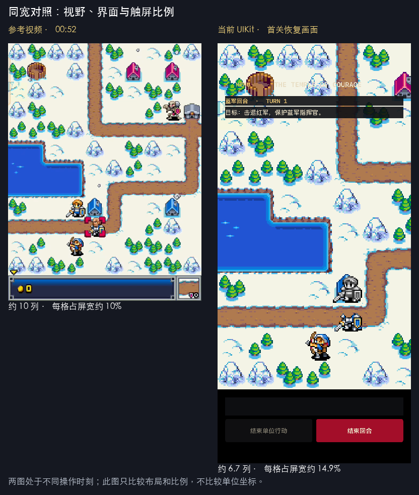

# 《Ancient Empires II [Java ME/J2ME Loader] [NA]》视频对比

日期：2026-10-02。对照对象：用户提供的本地 MP4、当前 UIKit 实现、既有模拟器截图、所选 v2.5 JAR 阅读版及 `AEIIRM_src`。本次新增对比资料，未修改游戏实现。

后续用户决定：**保留当前触屏大格子，其它界面尽量对齐原版**。因此下文 44–48pt 建议不再作为实施要求；实施状态见 [原版对齐清单](ORIGINAL_ALIGNMENT.md)。本报告保留原始对比证据。

## 结论

当前版已经接入原地图、图块、部分兵种规则和首关可玩流程，但与视频相比，**视野、原版界面、操作阶段、剧情演出和战斗演出仍有明显差距**。上一次 18/18 测试通过能证明现有流程可运行，不能证明原版效果和触发时机已还原；其中教程测试还明确断言了提前触发的行为。

差异并非只在格子大小。首要工作应是校正“选中 → 路径预览 → 移动 → 行动选择 → 结束行动”的阶段边界，再恢复原版表现。仍采用纯 UIKit；现代触屏尺寸与原版规则、资源和演出可以同时保留。



上图左侧为视频 00:52，右侧为上轮 UI 测试保存的首关恢复截图。两图不是同一个操作时刻，只用于比较布局与比例，不能据此比较单位位置、数量或伤害。

## 1. 证据和覆盖范围

- 视频：`.noindex/reference-videos/Ancient Empires II [Java ME⧸J2ME Loader] [NA].mp4`，720×960、30fps、2310.618 秒（约 38:31），含 AAC 音轨。
- 通览：每 60 秒抽一帧至 38:00，另取 38:30；前 80 秒每 2 秒采样，90–210 秒每 10 秒采样，另检查后续关卡代表画面。
- 时序细查：标题 00:00–00:06 每 0.5 秒；移动 00:57–01:00.75 每 0.25 秒；攻击 02:05–02:18.50 每 0.5 秒。标题形状匹配另采样前 2.6 秒的 30fps 帧。
- 当前版：重新读取实际 Swift 文件；视觉基准来自上轮 `testFullscreenBattlefieldRestoresActionAfterProcessRestart` 的 1206×2622 截图。本次没有重新录制整场 UIKit 游戏，也没有重跑测试。
- 原行为：用视频与 `AEIIRM_src`、`reference/java-named` 对照。视频没有可确认的 JAR 哈希或版本页，不能由文件名 `[NA]` 推定它就是工作区的 v2.5。跨版本的数值差异仍以基准 JAR 为准。
- 本报告是关键帧与关键过程对比，不是全片逐帧验收；没有完成音乐、音色或音画同步的听音对比。

[证据清单与哈希](../reference/video-comparison/j2me-loader-na/evidence.json)记录了视频、选定帧、当前截图及本次读到的 Swift 源文件指纹。

## 2. 画面与功能差异

| 项目 | 视频证据 | 当前实现 | 判断 |
| --- | --- | --- | --- |
| 标题展开 | 00:00–00:02.50：黑底上文字从中央扭动展开；约 00:03 人物背景已显现 | 有逐行波形、淡入和扫光实现 | 算法方向吻合；完整显示尺寸、字体、淡入混合和真实 UIKit 播放节奏未完成视频验收 |
| 主菜单 | [00:06](../reference/video-comparison/j2me-loader-na/00-06-menu.png)：封面上环形图标；00:05–00:06 可见图标旋转、展开；00:08 为下一层菜单 | 封面下方纵向堆叠关卡标题与现代按钮 | 菜单结构和动画未还原 |
| 关卡前情 | [00:18](../reference/video-comparison/j2me-loader-na/00-18-introduction.png)：上方插画、下方向上滚动的文字；00:26–00:28 独立关卡标题 | 进入首关后直接显示地图和底部“开始序幕” | 插画前情、滚字、关卡标题和入场转场缺失 |
| 地图视野 | [00:52](../reference/video-comparison/j2me-loader-na/00-52-battlefield.png)：横向约 10 格，地图为主要画面 | 402pt 宽手机首关单格达到 60pt，仅约 6.7 格 | 当前放大过度，丢失战术上下文 |
| HUD | 00:52：底部深蓝银边条、金币数和地形/防御图标；[02:08](../reference/video-comparison/j2me-loader-na/02-08-target-selection.png)：攻击时顶部显示双方属性 | 顶部常驻关卡名、回合和目标；底部文字块与两个大按钮 | 颜色、边框、信息组织和出现时机都有差异；菜单文字压在亮色雪地上，对比度不足 |
| 剧情对话 | [00:32](../reference/video-comparison/j2me-loader-na/00-32-dialogue.png)、[24:00](../reference/video-comparison/j2me-loader-na/24-00-dialogue.png)：人物头像突出于底部深蓝对话框，文本分页/滚动，右下提示 | 无头像的系统字体文本框和红色“继续”按钮，固定最多 4 行 | 原版人物辨识和对话节奏缺失；长文本完整显示需要单独验收 |
| 任务目标 | [00:46](../reference/video-comparison/j2me-loader-na/00-46-objective.png)：居中的 `TEMPLE RAIDERS` 任务提示及指挥官生存条件 | 顶部常驻一行中文目标 | 内容大意相近，呈现方式未对齐 |
| 光标和移动范围 | [00:54](../reference/video-comparison/j2me-loader-na/00-54-movement-help.png)、00:57–00:57.50：红紫色范围、四角光标和带终点的路线箭头 | 蓝色半透明范围、金色矩形选中框；无路线箭头 | 已有原始 cursor/arrow 资源，但尚未接入 |
| 移动和行动 | 00:57.75–00:58.25：沿路径移动并出现尘土；00:58.50：`END MOVE`；02:07.50：`ATTACK` | 点击目标格立即改坐标；点击可攻击敌人立即结算；固定结束单位/回合按钮 | 移动演出、路径预览、行动选择和目标确认阶段缺失 |
| 单位表现 | 00:58.50 单位仍保留阵营色；结束行动后变灰。03:55 可见受伤单位的地图 HP 数字 | 从 `unit_icons.png` 的第 0 行截静态图；`hasMoved || hasActed` 即变灰；HP 只在选中详情中显示 | 变灰过早；待机/移动帧、地图 HP 和指挥官头部叠层未接入 |
| 单位详情 | [01:50](../reference/video-comparison/j2me-loader-na/01-50-unit-details.png)：Galamar 名称、HP、经验条、攻击/防御/移动和能力说明 | 底部两行坐标、地形、HP、等级、阵营 | 资料面板不完整 |
| 战斗演出 | 02:08.50–02:10：竖条转场；[02:11](../reference/video-comparison/j2me-loader-na/02-11-battle.png)起：左右战场、角色群、挥砍/弹道、伤害飘字、减员、反击和 HP 变化 | `session.attack` 同步完成先攻和反击，底部显示一行伤害 | 这是最显著的体验缺口之一，侧面战斗未实现 |
| 回合、经济和建筑 | [03:00](../reference/video-comparison/j2me-loader-na/03-00-new-turn.png)：`NEW TURN! INCOME: 60`；[09:00](../reference/video-comparison/j2me-loader-na/09-00-repair.png)：`REPAIR` | 一次调用处理全部红军行动，刷新成下个蓝军回合；当前会话没有资金、收入、修复命令 | 回合演出和相应规则均未完整接入 |
| 后续内容 | 07:45、23:55 出现不同地图；后段有水上单位、飞行单位和更多战斗背景 | 应用入口与继续战役均固定加载 m0 | 当前只有首关切片，不能认定覆盖整段视频 |

当前地图控制器证据：[布局与缩放](../App/UI/CampaignMapViewController.swift:70)、[HUD](../App/UI/CampaignMapViewController.swift:194)、[对话框](../App/UI/CampaignMapViewController.swift:237)、[输入与即时攻击](../App/UI/CampaignMapViewController.swift:315)、[静态图标与灰图选择](../App/UI/CampaignMapViewController.swift:687)。菜单见 [MainMenuViewController](../App/UI/MainMenuViewController.swift:22)，启动入口见 [AppDelegate](../App/Application/AppDelegate.swift:57)。

## 3. 剧情触发点确实没有全部对齐

视频把“完成移动动画”和“结束单位行动”区分得很清楚。这是规则阶段差异，不能只调整提示框外观。

### 第一轮移动的可见时间线

| 视频时间 | 画面 |
| --- | --- |
| 00:52 | 基础操作说明已关闭，恢复地图浏览 |
| 00:54 | 选中单位后出现红紫色范围与范围教程 |
| 00:57.00–00:57.50 | 光标选目的格，绘制路线 |
| 00:57.75–00:58.25 | 单位沿路移动，尘土逐步出现 |
| 00:58.50–00:59.50 | 单位仍有蓝色/金色细节，显示 `END MOVE` |
| 00:59.75–01:00.00 | 行动菜单退出、单位变灰，出现地形教程 |

[连续帧证据](../reference/video-comparison/j2me-loader-na/movement-sheet-1.jpg)。这些时间包含玩家输入等待，只证明先后顺序，不是原游戏固定延迟。

### 与源码交叉核对

| 门槛 | 原源码 / v2.5 阅读版 | 当前 Swift | 差异 |
| --- | --- | --- | --- |
| 范围教程 197 | 脚本 case 15 等待玩家选中单位 `gameState == 1`，范围展开 `alphaWindowSize == 0` | 关闭 196 后立即排出 197 | 提前出现，未等待选择和范围演出 |
| 地形 198、灰图 199 | case 16/17 等待 `lastFinishedMoveUnit`；该值由 `Unit.finishMove()` 发布 | `move()` 设置位置与 `hasMoved` 后即发布 `lastFinishedMoveUnitID` | 把落格当成结束行动 |
| 全部行动提示 200 | case 18 统计 `unitState == 2` 的蓝军数量 | 统计 `hasMoved` 数量 | 已移动与已结束行动混为一体 |
| 攻击教程 203 | case 21 仍要求玩家回合且 `gameState == 1` | 关闭 202 后无选择条件，立即排出 203 | 又一次跳过输入门槛 |
| 灰图 | `Unit.finishMove()` 设置 `unitState = 2`；通常绘制只有此状态才用灰图 | `hasMoved || hasActed` 都绘制灰图 | 移动后、行动选择期间就已变灰 |

原源码证据：

- [MainDisplayable case 15–19](../reference/inputs/AEIIRM_src/src/aeii/MainDisplayable.java:8391)。
- [END MOVE 调用 finishMove](../reference/inputs/AEIIRM_src/src/aeii/MainDisplayable.java:2814)。
- [Unit.finishMove 设置行动状态并发布事件](../reference/inputs/AEIIRM_src/src/aeii/Unit.java:851)。
- v2.5 阅读版同样有这些门槛：[GameController](../reference/java-named/aeii/GameController.java:6802)、[Unit.method_56](../reference/java-named/aeii/Unit.java:710)、[灰图与地图 HP](../reference/java-named/aeii/Unit.java:759)。因此上述差异不只是猜测“视频可能是别的版本”。

当前证据：[move](../Packages/AncientEmpiresEngine/Sources/AECore/CampaignSession.swift:340)、[endUnitAction](../Packages/AncientEmpiresEngine/Sources/AECore/CampaignSession.swift:390)、[evaluateM0Script](../Packages/AncientEmpiresEngine/Sources/AECore/CampaignSession.swift:874)。

现有 [教程单元测试](../AppTests/CampaignSessionTests.swift:38)和 [UI 恢复测试](../AppUITests/AppFlowUITests.swift:47)恰好要求“关闭基础教程立即出现范围教程、移动立即出现地形教程”。它们证明实现与现有断言一致，没有验证原始门槛。后续修正时应先以原门槛重写验收条件。

开场也有类似的表现简化：当前 `moveOpeningUnits()` 直接设置三名蓝军坐标，特定对话推进时直接移除守卫；视频 00:30–00:44 有地图转场、镜头横向变化、守卫受击特效与消失。当前保留了部分结果和文本顺序，尚未保留演出过程。

## 4. 屏幕与格子应如何适配

当前计算式取宽度目标和高度目标中较大者：

```text
tile = min(60, max(30, max(windowWidth / 10, windowHeight * 0.85 / mapHeight)))
```

在 402×874pt、12×12 的首关中：宽度目标 40.2pt，高度目标约 61.9pt，最终被截为 60pt，横向约 6.7 列。与相同屏宽下的 10 列视野相比，单格边长约为 1.49 倍、面积约为 2.23 倍。这解释了为什么图片都来自原版，观感仍显得过度放大。

需要明确一个几何约束：12 行地图按 40.2pt 绘制，高度只有 482.4pt；若强求其覆盖 874pt 屏高的 85%，格子就会接近 62pt。现代长屏、方形短地图、“固定 10 列”与“纵向基本填满”不能同时严格满足。

建议的下一版验收基准：

1. 使用整窗 UIKit 地图视口，状态/操作区根据安全区组织；地图大小根据有效战场空间确定。
2. 手机默认优先评估 **44–48pt** 的格子；402pt 宽屏约 8.4–9.1 列。48pt 是原 24px 图块的 2 倍逻辑尺寸，触摸和像素放大都方便。提供缩放以查看更大范围。
3. 短地图单独处理居中和地图外背景，不再仅因为屏幕高就把所有格子推到 60pt。具体可用高度需要与实际 HUD 一起截图验收。
4. 原像素美术、坐标比例、光标和边框保持一致，文字与触控区域按设备可读性适配；触控按钮目标至少 44pt。
5. 用同一阶段的截图核对单位、道路、建筑和 HUD；全屏容器尺寸断言之外，必须记录实际格宽、可见列数、遮挡和可操作区域。

上述是待实施建议。本次没有调整格宽，不能把它们当成已落地效果。

## 5. 启动动画的新增证据

视频 00:00 已经处于扭动中，不能把第 0 秒当作算法进度 0。使用现有、由 JAR 取证生成的 `wave-00…40.png`，对视频前 2.6 秒的标题区作亮度阈值前景形状匹配：

- 裁切 `(0, 0, 720, 255)`，缩到 240×85；排除左侧 4 列；阈值 55。
- 30fps 采样；在前景 IoU > 0.7 的帧中匹配到 32 个不同进度，范围 p=5…39。
- 根据不同进度首次出现时间拟合，约 **64.921ms/步**，接近基准 JAR 的 66ms 逻辑目标。
- 展开阶段匹配帧的前景 IoU 中位数约 0.7802。它受缩放、压缩、阈值等影响，**不是“78% 还原率”**，也不能支持“整个 iOS 启动已 100% 一致”。

[匹配数据](../reference/video-comparison/j2me-loader-na/startup-video-shape-comparison.json) · [标题连续帧](../reference/video-comparison/j2me-loader-na/startup-sheet-1.jpg) · [既有原算法说明](../reference/reconstruction/STARTUP_ANIMATION.md)

当前 UIKit 标题仍把 240×320 画布按完整比例放进窗口。在 402×874pt 上其内容约为 402×536pt，上下各约 169pt 余白；这个布局与战场全屏适配是两个独立问题。`PRESS ANY KEY` 还有系统字体、可见按钮与画布提示标签的叠加/闪烁待核对。随后的视频环形菜单目前完全没有接上。

## 6. 已有资源可以直接支持哪些还原

| 表现 | 现有资源 / 参考实现 |
| --- | --- |
| 圆形菜单 | `res/menu_icons.png`、`menu_icons.sprite`；`reference/inputs/AEIIRM_src/src/aeii/AuxDisplayable.java` 的圆形菜单初始化、更新、绘制 |
| 人物对话 | `res/portraits.png`、`portraits.sprite`；当前对话控制器尚未使用 |
| 关卡前情 | `res/intro0.png` 等插画及原文字 ID |
| 光标、路线、HUD | `res/cursor_00…05.png`、`cursor.sprite`、`arrow.png`、`arrow_icons.png`、`hud_icons.png`、`hud_icons_2.png` |
| 指挥官头部 | `res/king_heads.png`、`king_heads_back.png` 等；原 `Unit` 绘制对 type 9 有独立头部叠层 |
| 尘土、受击、墓碑 | `res/smoke.png`、`b_smoke.png`、`spark.png`、`redspark.png`、`tombstone.png` 及对应序列 |
| 战斗 | 各阵营 `king_*`、`soldier.png`、其它兵种图集；`kingslash`、`kingwave`、箭矢等；`BattleSideView.java` 与 `.sprite` 描述 |
| 音频 | `main_theme.mid`、`bg_story.mid`、`bg_good/bad.mid`、`battle_good/bad.mid`、胜败曲等；当前 App 没有音频播放接线 |

这些资源存在不等于已经还原对应行为。尤其动作帧、锚点、朝向、动画持续时间和随机消费，需要结合原调用链接入。

## 7. 建议调整顺序及验收

1. **阶段和教程门槛。** 先区分选中、范围就绪、移动结束、行动选择、行动结束；恢复 197–200、203 的原门槛及变灰时机。验收：未结束行动时不弹地形教程、不变灰；结束一次行动只消费一次事件；中途保存恢复不重复提示。
2. **地图与 HUD。** 调整可见列数，恢复原版深蓝银边条、地形图标、HP 标记、光标和路线。验收：既满足触控目标，也能保留战术视野；以截图审查文字对比度和遮挡。
3. **菜单和叙事。** 接入圆形菜单、前情滚字、任务横幅、人物头像、长文本分页、剧情镜头和入场转场。验收：对应 00:05–00:54 的事件顺序与角色身份。
4. **动作和战斗。** 移动帧/尘土、逐单位敌军行动、左右战斗、弹道、伤害、减员、反击、回合横幅。验收：对应 00:57–01:00 和 02:05–02:18.50 的阶段顺序；HP 只结算一次，恢复不重抽随机数。
5. **经济、建筑和其它关卡。** 收入、修复/占领、招募/复活、其它兵种和完整关卡链分别对照原源码和视频；不能用 m0 通关作为全游戏验收。

涉及随机伤害、AI 目标或回合数时，视频的未知种子和玩家输入不能作为精确数值基准。应固定相同规则输入与随机状态后比较；动画与 UI 时序另行验收。

## 8. 附件索引

- [同宽对照图](../reference/video-comparison/j2me-loader-na/layout-comparison.png)
- [全片概览 00:00–19:00](../reference/video-comparison/j2me-loader-na/overview-sheet-1.jpg)
- [全片概览 20:00–38:00](../reference/video-comparison/j2me-loader-na/overview-sheet-2.jpg)
- [首次移动连续帧](../reference/video-comparison/j2me-loader-na/movement-sheet-1.jpg)
- [首次攻击与战斗连续帧 1](../reference/video-comparison/j2me-loader-na/battle-sheet-1.jpg)
- [首次攻击与战斗连续帧 2](../reference/video-comparison/j2me-loader-na/battle-sheet-2.jpg)

抽帧可用以下命令复现，`-ss` 为视频时间秒数：

```sh
ffmpeg -v error -ss 58.5 \
  -i '.noindex/reference-videos/Ancient Empires II [Java ME⧸J2ME Loader] [NA].mp4' \
  -frames:v 1 .noindex/artifacts/j2me-loader-comparison/check-58.50.png
```
